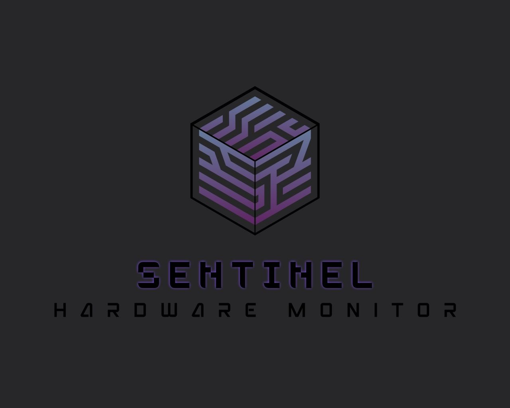

# SENTINEL Hardware Monitor

Ein modularer Desktop-Hardware-Monitor für Windows, entwickelt in Python (Tkinter).
Entstanden als praxisorientierte Projektarbeit im Rahmen der Zertifizierung zum **Software Developer (IHK)** inklusive vollständiger Projektdokumentation und Abschlusspräsentation vor dem Prüfungskomitee.

<p align="center">
  
</p>

---

## Projektüberblick & Motivation

Ziel des Projekts war die Konzeption und Realisierung einer leichtgewichtigen Windows-Desktopanwendung zur Erfassung und Überwachung relevanter Hardware-Parameter in Echtzeit.

Anstatt auf vorgefertigte Komplettlösungen zurückzugreifen, sollte das System von Grund auf modular aufgebaut werden. Der Fokus lag auf:

* **Objektorientierter Programmierung (OOP)** und modularer Softwarearchitektur
* **Systemnaher Datenabfrage** unter Windows über WMI und `psutil`
* **Entwicklung einer responsiven grafischen Benutzeroberfläche** mit Tkinter
* **Qualitätssicherung** durch modulare Unit-Tests mit Mocking

Die vollständige Projektdokumentation nach IHK-Standard ist im Ordner [`docs/`](docs/) hinterlegt.

---

## Systemarchitektur & Aufbau

Die Anwendung orientiert sich am **Model-View-Controller (MVC)**-Muster, um eine saubere Trennung von Geschäftslogik (Hardware-Abfrage), Darstellung (Tkinter-Frames) und Navigation (Hauptfenster) zu gewährleisten.

```text
sentinel-hardware-monitor/
├── docs/                                    # Projektdokumentation (PDF) & Assets
│   ├── Projektdokumentation_Florian_Schimbold.pdf
│   └── Sentinel_Logo_v2.jpg
├── src/                                     # Quellcode der Anwendung
│   ├── sentinel_hardware_monitor_final.py   # Hauptprogramm & Frame-Controller
│   ├── sentinel_cpu_info.py                 # CPU-Monitoring & Kernauslastung
│   ├── sentinel_gpu_info.py                 # GPU-Daten & Videospeicher
│   ├── sentinel_ram_info.py                 # RAM- & Swap-Status (psutil)
│   ├── sentinel_datenspeicher_info.py       # Festplatten-Info & I/O-Benchmark
│   ├── sentinel_mainboard_bios_info.py      # Mainboard- & BIOS-Parameter
│   └── ueber_sentinel.py                    # Info-Frame
└── tests/                                   # Unit-Tests
    ├── test_hauptfenster.py                 # Tests für Navigation & Frame-Management
    └── test_modul_cpu.py                    # Mocking-Tests für CPU-Daten
```

---

## Funktionsumfang

* **Hauptprozessor (CPU):** Statische Daten (Modell, physische/logische Kerne, Maximaltakt) sowie dynamische Auslastung aller einzelnen Kerne in Echtzeit.
* **Grafikkarte (GPU):** Auslesen von Modellbezeichnung, Adapter-RAM, Treiberversion und 3D-Auslastung.
* **Arbeitsspeicher (RAM):** Physische Speichermodule (Hersteller, Kapazität, Seriennummern) sowie dynamische Auslastung von RAM und Windows-Auslagerungsspeicher (Swap).
* **Datenspeicher & Benchmark:** Identifikation verbauter Laufwerke (SSD/HDD) inklusive integriertem Schreib- und Lesegeschwindigkeitstest (temporäre 100-MB-Datei, gemessen über `time.perf_counter`).
* **Mainboard & BIOS:** Hersteller, Board-Modell, BIOS-Version und Release-Datum via WMI.
* **Standalone-Fähigkeit:** Jedes Modul besitzt einen eigenständigen `if __name__ == "__main__":`-Block und kann unabhängig vom Hauptfenster isoliert gestartet und getestet werden.

---

## Qualitätssicherung & Tests

Um die Codequalität sicherzustellen, wurden Unit-Tests mit Pythons `unittest`-Framework umgesetzt:

* **Frame-Management (`test_hauptfenster.py`):** Überprüfung, ob alle Seiten-Frames beim Start korrekt im Dictionary registriert und fehlerfrei per `tkraise()` navigiert werden.
* **Hardware-Mocking (`test_modul_cpu.py`):** Da Hardware-Abfragen auf Zielsystemen variieren können, wurden WMI- und `psutil`-Aufrufe über `unittest.mock` isoliert und mit Testdaten validiert.

---

## Lessons Learned & Limitationen

* **WMI-Latenzen:** WMI-Abfragen über den Windows-Dienst `root\CIMV2` sind vergleichsweise ressourcenintensiv. Bei zu kurzen Abfrageintervallen führt dies zu messbaren Verzögerungen in der Benutzeroberfläche.
* **Timeboxing & Projektumfang:** Das ursprüngliche Fachkonzept sah Echtzeit-Graphen, On-Screen-Display (OSD) und eine Datenbankanbindung vor. Im Rahmen des 80-Stunden-Zeitbudgets wurde der Fokus pragmatisch auf die Kernfunktionen und ein stabiles modulares Gerüst gelegt.

---

## Roadmap

Asynchrones Auslesen der Hardware-Werte über Worker-Threads zur Entlastung des Tkinter-Mainloops

Visualisierung der CPU-/GPU-Verläufe mittels Live-Diagrammen

Auslesen systemspezifischer Temperatursensoren

Konfigurierbare Schwellwertwarnungen bei kritischer Auslastung

---

*Abschlussprojekt zur IHK-Zertifizierung „Software Developer (IHK)“ – Florian Schimbold*
